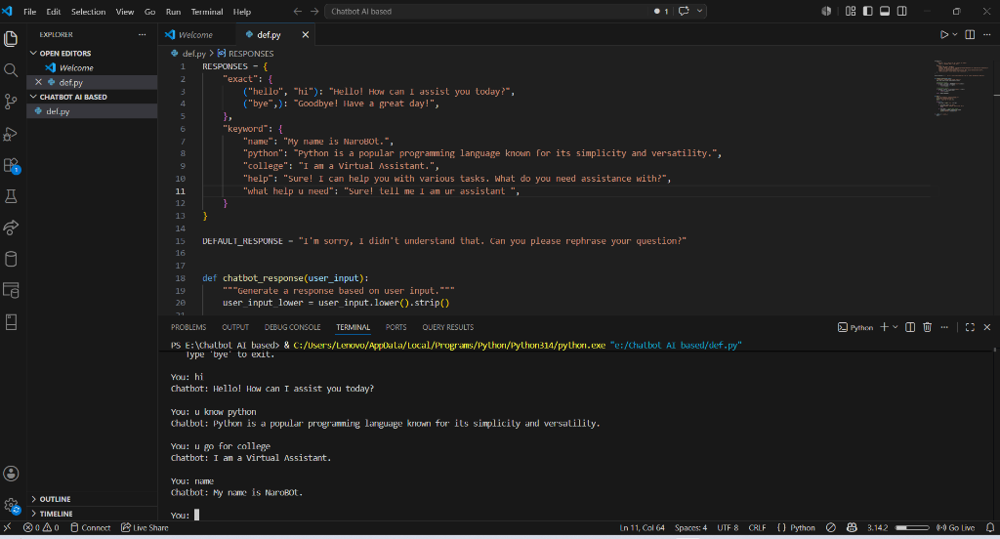

# 🤖 NaroBot - Rule-Based AI Chatbot

A lightweight, interactive command-line chatbot built with Python. NaroBot resolves user queries using a structured dictionary of exact matches and keyword triggers, providing quick and intelligent responses with a fallback mechanism for unrecognized inputs.

---

## 📸 Demo & Screenshot

Here is NaroBot in action, showing exact matches and keyword detections:



---

## ✨ Features

- **Exact Match Parsing**: Matches specific phrases (e.g., `"hello"`, `"hi"`, `"bye"`) for standard greetings and farewells.
- **Keyword Spotting**: Scans user input for specific keywords (e.g., `"python"`, `"college"`, `"name"`) and responds based on context, even if the keyword is part of a larger sentence.
- **Input Normalization**: Converts user input to lowercase and strips leading/trailing whitespaces to ensure robust matching.
- **Interactive Console Interface**: A continuous, real-time command-line prompt for seamless conversation.
- **Graceful Termination**: Exits immediately when the user inputs `"bye"`.
- **Default Fallback**: Automatically provides a polite default response when it doesn't understand the user's message.

---

## 🛠️ How It Works

The chatbot uses a pre-defined dictionary structure for its knowledge base and parses queries through a two-tier matching system:

1. **Exact Match Search**: The bot first checks if the sanitized input matches any keys in the `exact` response map.
2. **Keyword Scan**: If no exact match is found, it iterates through the `keyword` response map, checking if any key is contained within the user's input.
3. **Fallback**: If both checks fail, it falls back to a preconfigured default response.

### Core Architecture (`def.py`)

```python
# Exact mapping (tuples of inputs) vs Keyword mapping (substring matching)
RESPONSES = {
    "exact": {
        ("hello", "hi"): "Hello! How can I assist you today?",
        ("bye",): "Goodbye! Have a great day!",
    },
    "keyword": {
        "name": "My name is NaroBOt.",
        "python": "Python is a popular programming language known for its simplicity and versatility.",
        "college": "I am a Virtual Assistant.",
        "help": "Sure! I can help you with various tasks. What do you need assistance with?",
        "what help u need": "Sure! tell me I am ur assistant ",
    }
}
```

---

## 🚀 Getting Started

### Prerequisites

- **Python 3.x** installed on your system.

### Running the Chatbot

1. Open your terminal or command prompt.
2. Navigate to the project directory:
   ```bash
   cd "E:\Chatbot AI based"
   ```
3. Run the Python script:
   ```bash
   python def.py
   ```
4. Start chatting! Type `bye` to exit.

---

## 💬 Conversation Examples

| User Input | Matched Type | Chatbot Response |
| :--- | :--- | :--- |
| `hi` | **Exact** | *Hello! How can I assist you today?* |
| `do you know python?` | **Keyword** | *Python is a popular programming language known for its simplicity and versatility.* |
| `what is your name` | **Keyword** | *My name is NaroBOt.* |
| `tell me about your college` | **Keyword** | *I am a Virtual Assistant.* |
| `random question` | **None** | *I'm sorry, I didn't understand that. Can you please rephrase your question?* |
| `bye` | **Exact (Exit)** | *Goodbye! Have a great day!* |

---

## 📂 Project Structure

```text
Chatbot AI based/
│
├── def.py            # Main application logic and response database
├── screenshot.png    # Screenshot showing terminal execution
└── README.md         # Project documentation (this file)
```
# Documentation updates
